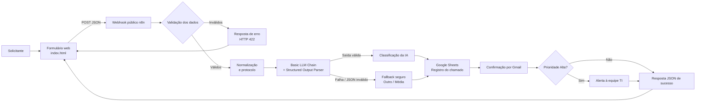

# Triagem Inteligente de Chamados de Suporte de TI

Protótipo acadêmico de automação de atendimento de TI com **n8n, IA, Google Sheets, Gmail e uma página web própria**. A solução recebe um problema, valida os dados, gera protocolo, sugere uma classificação e registra o pedido para que a equipe possa priorizar o atendimento.

## Demonstração online

Acesse a versão publicada na Vercel: **[https://sistema-de-triagem-eosin.vercel.app/](https://sistema-de-triagem-eosin.vercel.app/)**.

> **Estado do projeto:** a página está configurada para chamar o webhook de produção do n8n. Como a URL fica no JavaScript do navegador, ela é visível a qualquer visitante — endpoints públicos precisam de validação, controle contra abuso e monitoramento. O JSON exportado do workflow n8n não fazia parte dos arquivos fornecidos para preparar este repositório; consulte [Configuração do n8n](docs/configuracao-n8n.md) para revisar o fluxo.

## Sumário

- [Problema e objetivo](#problema-e-objetivo)
- [Desenho da solução](#desenho-da-solução)
- [Como funciona](#como-funciona)
- [Tecnologias e justificativa](#tecnologias-e-justificativa)
- [Estrutura do repositório](#estrutura-do-repositório)
- [Configuração e execução](#configuração-e-execução)
- [Validação e classificação](#validação-e-classificação)
- [Testes](#testes)
- [Análise crítica](#análise-crítica)
- [Segurança e privacidade](#segurança-e-privacidade)
- [Limitações e próximos passos](#limitações-e-próximos-passos)

## Problema e objetivo

Em pequenas e médias empresas, solicitações de suporte podem chegar por mensagens, ligações e conversas informais. Sem um registro centralizado, os pedidos podem se perder, a prioridade pode ser definida de maneira inconsistente e incidentes que afetam muitas pessoas podem esperar junto de solicitações simples.

O objetivo é demonstrar como uma abordagem **Low Code / No Code / Vibecode** pode automatizar uma parte do processo de suporte: a pessoa registra o problema em uma página web, a IA ajuda na triagem, o pedido é guardado em uma planilha e as pessoas envolvidas recebem notificações.

### Público beneficiado

- **Solicitantes:** recebem protocolo e confirmação do recebimento.
- **Equipe de TI:** recebe registros estruturados e um alerta adicional para prioridades altas.

### Dentro do escopo

- Formulário de abertura de chamado e tela de confirmação.
- Validação e normalização de dados.
- Geração de protocolo.
- Classificação assistida por IA: categoria, prioridade, resumo e sugestão inicial.
- Caminho alternativo (fallback) quando a IA falhar.
- Registro em Google Sheets e notificações por Gmail.
- Alerta à equipe para chamados de prioridade alta.

### Fora do escopo atual

Login de usuários, consulta de status pelo solicitante, atribuição automática de técnicos, SLA, histórico de interações e painel de indicadores.

## Desenho da solução



Versão-fonte do diagrama: [`docs/arquitetura.mmd`](docs/arquitetura.mmd). O desenho representa a arquitetura pretendida/documentada; a ordem final dos nós, o comportamento de erros e a configuração das credenciais devem ser conferidos no workflow efetivamente publicado no n8n.

## Como funciona

1. **Entrada:** o solicitante preenche nome, e-mail, setor e descrição.
2. **Validação no navegador:** a página verifica o nome (mínimo de 3 caracteres), o formato do e-mail, o setor e a descrição (mínimo de 20 caracteres). A validação do servidor também deve existir no n8n; validação apenas no navegador pode ser contornada.
3. **Webhook:** a página envia os campos em JSON por uma requisição `POST`.
4. **Normalização e protocolo:** os dados são limpos, o e-mail é convertido para minúsculas e o workflow gera um protocolo no formato `CH-AAAAMMDD-XXXX`.
5. **Classificação:** a IA propõe categoria, prioridade, resumo e sugestão inicial, seguindo um formato estruturado.
6. **Fallback:** quando a chamada à IA falha ou a resposta não pode ser usada, o fluxo deve continuar com valores padrão e marcar `classificado_por_ia = false`.
7. **Registro:** os dados do chamado são adicionados ao Google Sheets com status inicial `Aberto`.
8. **Notificações:** o solicitante recebe uma confirmação por Gmail; chamados com prioridade `Alta` também geram um alerta à equipe de suporte.
9. **Retorno à página:** o webhook retorna JSON com o protocolo e os dados resumidos para exibir a confirmação.

## Tecnologias e justificativa

| Tecnologia | Papel no projeto |
|---|---|
| **n8n Cloud** | Orquestração visual, validações, ramificações, tratamento de erros e integrações. |
| **OpenAI / nó de IA** | Sugestão de categoria, prioridade, resumo e orientação inicial. |
| **Structured Output Parser** | Ajuda a manter a resposta da IA em uma estrutura previsível. |
| **Google Sheets** | Registro tabular dos chamados. |
| **Gmail** | Confirmação ao solicitante e alerta de urgência. |
| **HTML, CSS e JavaScript** | Formulário independente, validação no cliente e apresentação da resposta. |
| **Vercel** | Hospedagem da página web estática e publicação da demonstração online. |

### Por que n8n?

- **Zapier:** simples de iniciar, mas automações com ramificações e tratamento de falhas podem esbarrar nos limites dos planos.
- **Make:** visual e flexível; o modelo por operação deve ser considerado à medida que o fluxo cresce.
- **Bubble / Adalo:** fortes na construção de interfaces de aplicações, mas neste caso exigiriam compor a automação e as integrações.
- **n8n:** concentra em um mesmo workflow as condições, o tratamento de falhas, a integração com IA e a comunicação com serviços externos. Isso combina com o objetivo demonstrativo do projeto.

Preços, limites de plano e créditos de IA variam. Consulte a documentação e os preços oficiais antes de estimar custos para um uso real.

## Estrutura do repositório

```text
triagem-inteligente-chamados-ti/
├── index.html                 # Página de abertura de chamado
├── README.md                  # Visão geral e documentação principal
├── .gitignore
└── docs/
    ├── arquitetura.mmd        # Fonte Mermaid do desenho da solução
    ├── configuracao-n8n.md    # Componentes e preparação do workflow
    ├── prompt-n8n.md          # Prompt-base utilizado para construir o fluxo
    └── casos-de-teste.md      # Cenários, resultados esperados e status conhecido
```

## Configuração e execução

### 1. Preparar o workflow no n8n

Siga [`docs/configuracao-n8n.md`](docs/configuracao-n8n.md). Em termos gerais, é necessário configurar o webhook, validações, geração do protocolo, IA e fallback, registro no Sheets, notificações e resposta JSON. O endpoint do webhook precisa responder ao `POST` da página e permitir a origem de hospedagem da página nas regras de CORS, quando aplicável.

### 2. Configurar a página

A URL do webhook de produção do n8n já está configurada em `index.html`. Se precisar alterá-la, edite a constante `WEBHOOK_URL` e publique o commit. Com o projeto da Vercel conectado a este repositório, a alteração deve disparar uma nova publicação. **Não coloque senhas, tokens de API ou credenciais de Google/OpenAI no HTML.** A URL do webhook estará visível no navegador; o fluxo n8n deve validar os dados no servidor e implementar controles contra chamadas indevidas.

### 3. Testar localmente

Como a página é estática, basta abrir `index.html` no navegador para conferir a interface e a validação local. Para testar o envio ao workflow, use a URL de webhook configurada e confirme também o funcionamento do CORS. Faça primeiro testes com dados fictícios.

### 4. Publicação na Vercel

A demonstração do projeto está publicada em [https://sistema-de-triagem-eosin.vercel.app/](https://sistema-de-triagem-eosin.vercel.app/).

Para atualizar a publicação, confira se o projeto da Vercel está conectado ao repositório e à branch corretos. Após novos commits, verifique o deployment e teste o formulário com dados fictícios. Confirme também se a URL do webhook usada no ambiente de produção está configurada corretamente e se o n8n permite a origem da página quando necessário.

A Vercel hospeda a interface web; o processamento do workflow e as integrações continuam acontecendo no n8n.

## Validação e classificação

### Campos recebidos

| Campo | Regra principal |
|---|---|
| `nome` | Obrigatório; pelo menos 3 caracteres. |
| `email` | Obrigatório; formato de e-mail válido. Normalizado para minúsculas. |
| `setor` | Obrigatório; Financeiro, RH, Comercial, Operações ou Outro. |
| `descricao` | Obrigatória; pelo menos 20 caracteres após remover espaços nas extremidades. |

### Categorias aceitas

`Hardware`, `Software`, `Rede/Internet`, `Acesso/Senha` e `Outro`.

### Critérios de prioridade

- **Alta:** impede o trabalho de várias pessoas ou envolve um possível incidente de segurança.
- **Média:** impede o trabalho de uma pessoa.
- **Baixa:** incômodo sem bloqueio relevante do trabalho.

A classificação da IA é uma sugestão para triagem e não deve substituir a decisão humana em incidentes críticos. A equipe deve revisar os casos de segurança e prioridades elevadas.

### Fallback da IA

Quando a IA falhar, o comportamento definido para o protótipo é:

- `categoria`: `Outro`
- `prioridade`: `Média`
- `resumo`: primeiros 100 caracteres da descrição
- `sugestao_inicial`: `Nossa equipe analisará seu chamado em breve.`
- `classificado_por_ia`: `false`

O caminho alternativo deve preservar o registro e permitir que o solicitante saiba que a triagem automática não foi concluída.

### Registro no Google Sheets

Colunas esperadas:

`protocolo`, `data_abertura`, `nome`, `email`, `setor`, `descricao`, `categoria`, `prioridade`, `resumo`, `classificado_por_ia`, `status`.

O campo `status` começa em `Aberto`.

## Testes

Os cenários e os resultados conhecidos estão detalhados em [`docs/casos-de-teste.md`](docs/casos-de-teste.md). O material compartilhado durante o desenvolvimento registrava apenas o cenário de prioridade alta como aprovado com dados simulados; os outros casos ainda estavam pendentes naquele registro. Atualize a documentação com os resultados reais antes de apresentar o projeto como totalmente testado.

## Análise crítica

### Três vantagens

1. **Rapidez de desenvolvimento:** o editor visual e o auxílio de IA aceleram a montagem do fluxo e permitem demonstrar o processo sem construir um backend inteiro do zero.
2. **Lógica visível:** validações, caminhos alternativos e ramificações por prioridade ficam mais fáceis de inspecionar visualmente.
3. **Integração de serviços:** IA, planilha e e-mail colaboram em um fluxo único, reduzindo tarefas manuais repetitivas.

### Três limitações

1. **Dependência da plataforma e dos limites de uso:** disponibilidade, preços, créditos e mudanças de serviço podem afetar a solução.
2. **Erros de classificação:** modelos de linguagem podem interpretar incorretamente a gravidade ou a categoria; é necessário testar e manter revisão humana.
3. **Segurança e governança:** um webhook sem autenticação pode receber requisições indevidas; dados pessoais numa planilha exigem permissões restritas e controles de retenção.

## Segurança e privacidade

- O HTML contém a URL do webhook usada pelo frontend, visível aos visitantes porque a página é estática. Não trate essa URL como senha; proteja o workflow com validação no servidor, limitação de requisições, monitoramento e controles adequados contra abuso.
- Guarde credenciais no gerenciador de credenciais do n8n. Nunca adicione chaves, tokens ou senhas ao código, ao README ou aos commits.
- O webhook do protótipo é público e não tem autenticação por padrão. Para uso real, considere autenticação ou um mecanismo de acesso apropriado, limitação de requisições, monitoramento e proteção contra spam.
- Restrinja o compartilhamento da planilha a pessoas autorizadas. Ela contém nome, e-mail e descrição de problemas, que podem ser dados pessoais.
- Evite dados reais em demonstrações acadêmicas; utilize registros fictícios e remova dados desnecessários.
- Garanta que falhas ao registrar o chamado não sejam reportadas como sucesso. O fluxo precisa definir e testar como tratar falhas de Google Sheets e de envio de e-mails.
- Revise manualmente o fluxo exportado antes de compartilhar publicamente; remova IDs sensíveis, e-mails internos e configurações específicas do ambiente.

Este projeto é um protótipo educacional, não um service desk pronto para produção.

## Limitações e próximos passos

1. Exportar o workflow do n8n para um arquivo versionado, após revisar e remover informações específicas do ambiente.
2. Executar e registrar todos os casos de teste, incluindo falhas da IA e do Google Sheets.
3. Adicionar autenticação ou outra proteção apropriada ao endpoint e controles contra abuso.
4. Permitir consulta de status pelo protocolo.
5. Implementar atribuição de técnicos, SLA e histórico de interações.
6. Criar painel de indicadores de volume, categorias, prioridade e tempo de atendimento.
7. Incluir capturas de tela do protótipo e da execução real do workflow, sem dados pessoais ou segredos.

## Registro do projeto

Conforme o material de desenvolvimento compartilhado, o workflow foi organizado em cinco etapas lógicas — Entrada, Validação, IA, Registro e Notificações — com 29 nós. O material também registrava como pendentes a conexão das credenciais do Google Sheets e do Gmail. **Confirme o estado atual no n8n antes de usar esses detalhes em uma apresentação**, pois esta documentação não substitui a inspeção do workflow publicado.

---

Desenvolvido como projeto acadêmico sobre Low Code / No Code / Vibecode, com foco em automação de processos e uso responsável de IA.